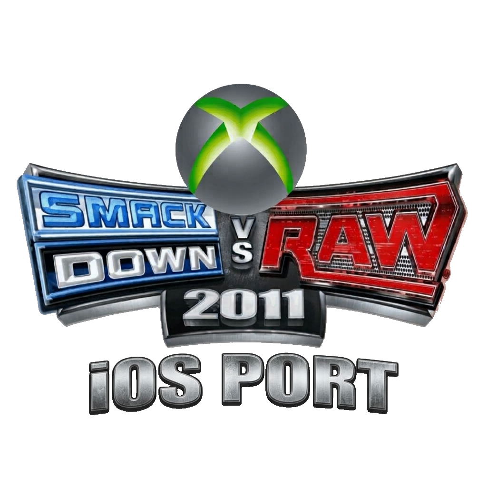

<h1 align="center">WWE SmackDown vs. Raw 2011 — iOS Port (Experimental)</h1>

  
  
  

  

> [!WARNING]
> **This is an experimental repository!**
>
> This repository is intended for personal experiments, testing, and development.

> [!IMPORTANT]
> **Looking for the main project?**
>
> If you're here to download releases, follow development, or check out the main project's repository, please visit:
>
> 👉 **[WWE SvR11 iOS – Main Repository](https://github.com/Ke619/WWE-SvR11-IOS)**
